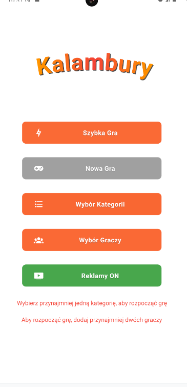
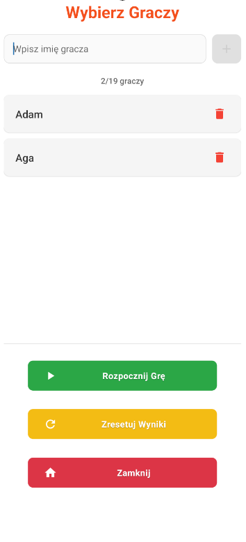
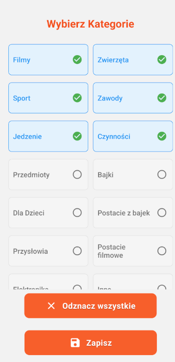
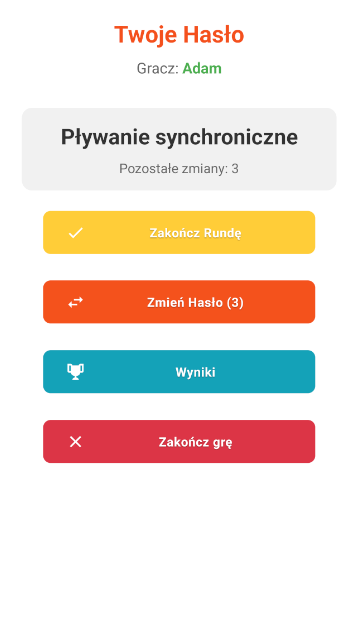
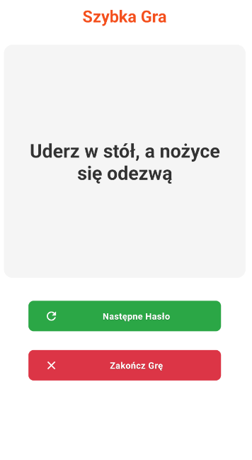

# Kalambury – Charades Party Game

A mobile charades game for parties and family evenings, built with **React Native (Expo)** and **TypeScript**.
Players take turns acting out a phrase while the others try to guess it – the app picks the phrases, tracks whose turn it is and keeps the score.

> The app's interface and phrase database are in Polish.

<p align="center">
  
  
  
  
  
</p>

## Features

- **Two game modes**
  - **New Game** – turn-based mode for 2–19 players with scoring. Each round the active player chooses one of two randomly drawn categories, gets a phrase and can swap it up to 3 times. The player who guesses correctly gets a point and takes the next turn.
  - **Quick Game** – no players or points, just draw random phrases one after another.
- **1,415 phrases in 14 categories** (movies, animals, sports, proverbs, cartoon characters and more), stored in a local SQLite database – the game works fully offline.
- **Category filter** – choose which categories are used in the game.
- **Persistent state** – players and selected categories survive an app restart.
- **Final scoreboard** with players sorted by score.
- Input validation (player name length, duplicates, player limit) and handling of edge cases such as an empty category.

## Tech stack

| Technology | Why |
| --- | --- |
| **Expo SDK 53 / React Native 0.79** | One codebase for Android and iOS, fast iteration and cloud builds with EAS. |
| **TypeScript** (`strict`) | Type safety for game state and component props. |
| **Expo Router** | File-based navigation – every screen is a file in `app/`. |
| **Zustand** + `persist` middleware | Lightweight global state without the boilerplate of Redux/Context. Only players, selected categories and settings are persisted to AsyncStorage (`partialize`). |
| **expo-sqlite** | Phrases are seeded from a JSON file into SQLite on first launch and queried per category with parameterized queries. |
| **Jest** (`jest-expo`) | Unit tests for the game logic. |
| **react-native-google-mobile-ads** | Banner ads with a graceful fallback when the native module is unavailable (e.g. in Expo Go). |

## Architecture

```
app/                    # Screens (Expo Router, file-based routes)
  home/                 #   main menu
  new-game/             #   turn-based game
  swiftplay/            #   quick game
  players/              #   player management
  categories/           #   category filter
  scoreboard/           #   current scores
components/             # Reusable UI components
  game/                 #   game phases: category choice, phrase display, scoring, final scores
  ads/                  #   ad banner
hooks/useGameLogic.tsx  # Round flow of the game screen (which phase is shown, handlers)
stores/gameStore.ts     # Zustand store: players, turns, scores, categories, current phrase
utils/db.ts             # SQLite access layer + seeding from assets/data/defaultData.json
utils/random.ts         # Fisher-Yates shuffle and random pick helpers
types/                  # Shared TypeScript types
constants/Colors.ts     # Color palette
```

Data flows in one direction:

```
Screen (app/new-game)  →  useGameLogic (round UI state)  →  gameStore (game state)  →  utils/db (SQLite)
```

Screens stay mostly presentational, the round flow lives in a custom hook, and all game rules (turn order, scoring, drawing phrases) are in the store – which makes them easy to unit test without rendering any UI.

## Getting started

**Requirements:** Node.js 20 LTS, npm, and either an Android emulator / iOS simulator or a physical device.

```bash
git clone https://github.com/Astilion/kalambury.git
cd kalambury
npm install
```

Run in **Expo Go** (quickest – ads are replaced with a placeholder):

```bash
npx expo start --go
```

Or build and run a **development build** with all native modules:

```bash
npx expo run:android   # or: npx expo run:ios
```

## Tests

```bash
npm test             # single run
npm run test:watch   # watch mode
```

The test suite covers the game store and helpers: adding/removing players and keeping the correct active player, scoring, category selection, drawing phrases (including the retry when a category is empty), the word-change limit and passing the turn. The database layer and AsyncStorage are mocked.

## What I learned

- Structuring a React Native app so that UI, flow logic and game rules are separated.
- Managing global and persisted state with Zustand.
- Working with a local SQLite database in a mobile app.
- Writing unit tests – they caught a real bug in how the active player was updated after removing a player.
- Preparing production builds with EAS (versioning, app icons, splash screen).

## Roadmap

- [ ] Versioned phrase database (`PRAGMA user_version`) so that phrase fixes reach existing installations.
- [ ] Round timer.
- [ ] Custom, user-defined categories and phrases.
- [ ] English language version.
- [ ] Publishing on Google Play.
